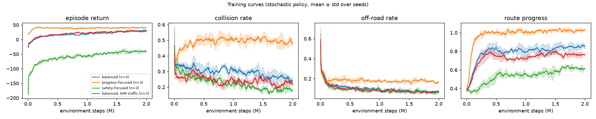
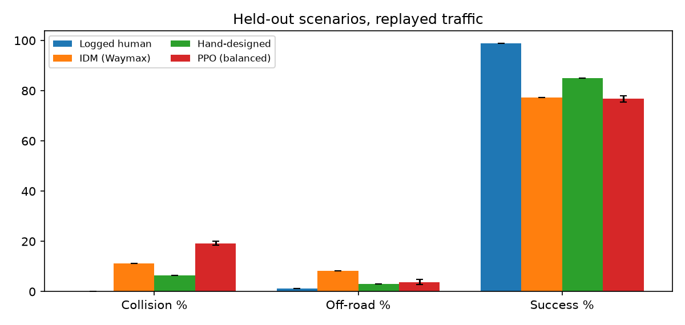
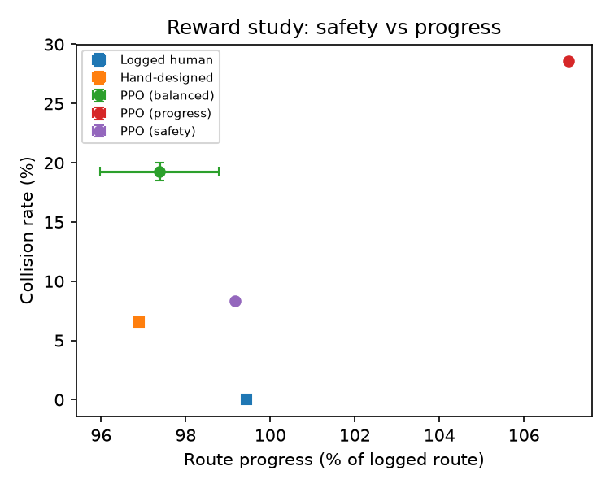
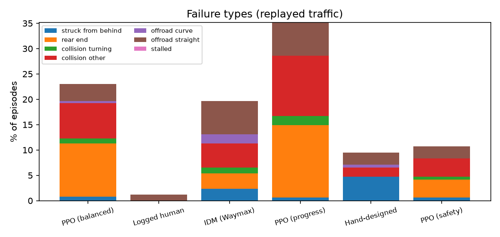

# Learning Safe Closed-Loop Driving Policies with PPO in Waymax

CSCE 642 Deep Reinforcement Learning, course project
Debmalya Chatterjee and Arvinder Singh Mundra

We train a PPO policy that drives one car (the ego) in closed loop through real
scenes from the Waymo Open Motion Dataset (WOMD), using the Waymax simulator, and
compare it with a hand-designed route-following controller, Waymax's IDM policy
driving the ego, and the logged human trajectory. All methods are evaluated on the
same held-out scenes.

## Layout

```
safedrive/
  compat.py      patches so Waymax runs on current JAX (tree_* aliases, 2D cross product)
  data.py        reads WOMD tfrecords, filters scenes, resamples the logged route, caches a bank
  geometry.py    projection onto the route, look-ahead points, ego-frame transforms
  env.py         single-agent env on top of PlanningAgentEnvironment: observation, action
                 mapping, reward, termination, hand-designed controller, expert and IDM ego
  ppo.py         PPO (Gaussian actor, MLP critic) in JAX/Flax, checkpointing and resume
  evaluate.py    deterministic rollouts, episode metrics, failure classifier
  render.py      top-down frames for the videos
scripts/
  build_cache.py  train.py  evaluate.py  make_plots.py  make_videos.py
configs/ppo.yaml  PPO hyperparameters
notebooks/colab_runner.ipynb  the same pipeline on a Colab GPU
results/  per-scenario CSVs, summary tables      figures/  plots
```

## Setup

Python 3.10+. Waymax is installed from GitHub without its loose pins:

```bash
python -m venv .venv && source .venv/bin/activate
pip install -r requirements.txt
pip install --no-deps "git+https://github.com/waymo-research/waymax.git@main#egg=waymo-waymax"
python -m pytest -q tests
```

Waymax has not been updated for JAX 0.6+. `safedrive/compat.py` restores the
`jax.tree_*` aliases and makes `jnp.cross` accept 2D vectors (used by Waymax's
off-road check); every module imports it before Waymax. We tested with JAX 0.12.1,
Flax 0.12 and TensorFlow 2.21 on Python 3.13 (CPU).

## Data

Register at https://waymo.com/open (non-commercial license), then download one
training and one validation shard of the v1.1.0 `tf_example` split:

```
data/womd/train/training_tfexample.tfrecord-00000-of-01000      (607 MB, 478 scenes)
data/womd/val/validation_tfexample.tfrecord-00000-of-00150      (368 MB, 288 scenes)
```

`scripts/build_cache.py` keeps scenes where the ego is tracked for all 91 steps and
moves at least 20 m, resamples the logged ego path to a 1 m route (extended 30 m past
its end), and keeps the 3,000 roadgraph points nearest that route. This leaves 266
training and 168 held-out validation scenes.

```bash
python scripts/build_cache.py --tfrecords data/womd/train/*00000-of-01000 --num 400 --out data/cache/train.pkl
python scripts/build_cache.py --tfrecords data/womd/val/*00000-of-00150 --num 300 --out data/cache/val.pkl
```

## Problem setup

- **Episode.** Waymax replays the first 1.1 s; the ego is then controlled for 80 steps
  (8 s at 10 Hz). The episode ends early on a collision (Waymax overlap check) or when
  the ego leaves the road (Waymax off-road check, run for the ego only because the
  stock metric checks all 32 objects and dominated the step time).
- **Observation (42 values).** Ego speed, heading error and lateral offset to the
  logged route, route progress, time left, last acceleration and curvature, five
  route points 5 to 25 m ahead in the ego frame, and (Δx, Δy, Δvx, Δvy, present) for
  the K = 5 nearest vehicles in the ego frame.
- **Action.** Normalised [acceleration, curvature] in [-1, 1], scaled to the bicycle
  model's bounds (±6 m/s², ±0.3 1/m).
- **Reward.** `r = w_p·progress − w_c·collision − w_o·offroad − w_a·control`.
  Progress is the arc length gained along the route, as a percentage of the logged
  route length (about 100 per episode when matching the human). It only counts up to
  5 m ahead of where the logged car was at that time. Without this cap the first runs
  learned to drive faster than the human and collided more, because extra progress
  outweighed the penalty. The control term penalises jerk, curvature change and
  braking harder than 3 m/s². Presets (w_c = w_o): progress-focused 10, balanced 50,
  safety-focused 200.
- **Traffic.** Other vehicles either replay their logs or follow Waymax's
  `IDMRoutePolicy` (desired speed 15 m/s) along their logged paths.

## Methods

- **PPO**: Gaussian actor and value MLPs (2×256, tanh), running observation
  normalisation, GAE (γ = 0.99, λ = 0.95), clip 0.2, 4 epochs × 8 minibatches,
  64 environments × 64 steps per update, 2M environment steps, learning rate 3e-4
  annealed. The initial policy std is e^-1.6 ≈ 0.2: with the CleanRL-style e^-0.5
  the steering noise alone made the car weave and training stalled near 40 %
  collisions.
- **Hand-designed controller**: pure pursuit on the logged route
  (look-ahead 4 m + 0.8 s × speed, clipped to 5–20 m) with an IDM speed rule
  (target = mean logged speed + 1 m/s, capped at 15 m/s; s0 = 2 m, T = 1.5 s,
  a = 2 m/s², b = 3 m/s²) on the nearest vehicle ahead within ±2 m laterally.
- **IDM (Waymax)**: Waymax's `IDMRoutePolicy` driving the ego along its logged path.
  It outputs states rather than bicycle actions, so it is not bicycle-constrained.
- **Logged human**: exact replay of the logged ego trajectory.

## Reproducing

```bash
for s in 0 1 2; do python scripts/train.py --reward balanced --seed $s --out runs/balanced_s$s; done
python scripts/train.py --reward safety   --seed 0 --out runs/safety_s0
python scripts/train.py --reward progress --seed 0 --out runs/progress_s0

RUNS="runs/balanced_s0 runs/balanced_s1 runs/balanced_s2 runs/safety_s0 runs/progress_s0"
python scripts/evaluate.py --traffic replay --out results/replay --methods expert idm_ego pure_pursuit $RUNS
python scripts/evaluate.py --traffic idm    --out results/idm    --methods expert pure_pursuit runs/balanced_s0 runs/balanced_s1 runs/balanced_s2
python scripts/make_plots.py
python scripts/make_videos.py --method runs/balanced_s0 --eval_csv results/replay/balanced_s0.csv --out videos/balanced_s0
```

Each PPO run takes about 8 minutes on a 2-core CPU (about 4,000 environment steps per
second) and resumes from `runs/<name>/checkpoint.pkl` if interrupted.

## Results

Held-out evaluation on 168 validation scenes (none of them seen in training),
deterministic policies (actor mean). PPO numbers are mean ± std over training seeds;
the reference methods are deterministic. Success = no collision, no off-road event
and at least 80 % of the logged route covered.

**Replayed traffic**

| Method | Seeds | Collision % | Off-road % | Route progress % | Success % | Return | Jerk (m/s³) | Δκ (1/m) |
|---|---|---|---|---|---|---|---|---|
| Logged human | 1 | 0.0 | 1.2 | 99.4 | 98.8 | 97.9 | 1.89 | 0.0007 |
| IDM (Waymax) | 1 | 11.3 | 8.3 | 120.4 | 77.4 | 88.4 | 2.99 | 0.0035 |
| Hand-designed | 1 | 6.5 | 3.0 | 96.9 | 85.1 | 89.8 | 0.76 | 0.0004 |
| PPO (balanced) | 3 | 19.2 ± 0.7 | 3.8 ± 1.0 | 97.4 ± 1.4 | 76.8 ± 1.3 | 79.4 ± 1.1 | 2.63 ± 0.35 | 0.0047 ± 0.0003 |
| PPO (progress) | 1 | 28.6 | 6.5 | 107.0 | 64.3 | 71.9 | 2.95 | 0.0069 |
| PPO (safety) | 1 | 8.3 | 2.4 | 99.2 | 88.1 | 89.6 | 2.02 | 0.0055 |

**Failure types (% of episodes, replayed traffic)**

|                    |   PPO (balanced) |   Logged human |   IDM (Waymax) |   PPO (progress) |   Hand-designed |   PPO (safety) |
|:-------------------|-----------------:|---------------:|---------------:|-----------------:|----------------:|---------------:|
| struck_from_behind |              0.8 |            0   |            2.4 |              0.6 |             4.8 |            0.6 |
| rear_end           |             10.5 |            0   |            3   |             14.3 |             0   |            3.6 |
| collision_turning  |              1   |            0   |            1.2 |              1.8 |             0   |            0.6 |
| collision_other    |              6.9 |            0   |            4.8 |             11.9 |             1.8 |            3.6 |
| offroad_curve      |              0.4 |            0   |            1.8 |              0   |             0.6 |            0   |
| offroad_straight   |              3.4 |            1.2 |            6.5 |              6.5 |             2.4 |            2.4 |
| stalled            |              0   |            0   |            0   |              0   |             0   |            0   |

**Reactive IDM traffic (same policies, no retraining)**

| Method | Seeds | Collision % | Off-road % | Route progress % | Success % | Return | Jerk (m/s³) | Δκ (1/m) |
|---|---|---|---|---|---|---|---|---|
| Logged human | 1 | 13.1 | 1.2 | 94.5 | 85.7 | 86.5 | 1.84 | 0.0007 |
| Hand-designed | 1 | 8.9 | 3.0 | 95.6 | 76.2 | 86.9 | 0.81 | 0.0004 |
| PPO (balanced) | 3 | 20.6 ± 2.7 | 4.8 ± 0.8 | 97.0 ± 0.6 | 74.2 ± 3.0 | 76.6 ± 2.0 | 2.76 ± 0.34 | 0.0048 ± 0.0002 |
| PPO (safety) | 1 | 19.0 | 2.4 | 94.7 | 78.0 | 79.0 | 2.01 | 0.0056 |






### What we found

- **H1 (PPO safer than the hand-designed controller): not supported with the balanced
  reward.** Balanced PPO collides in 19.2 ± 0.7 % of held-out scenes against 6.5 % for
  pure pursuit + IDM, at similar route progress (97 %). Its off-road rate is close
  (3.8 % vs 3.0 %). The safety-focused reward closes most of the gap (8.3 %
  collisions, 2.4 % off-road, 88.1 % success vs 85.1 %), but that is a single seed.
- **H2 (replay-trained policies get worse with reactive IDM traffic): mixed.**
  Balanced PPO barely changes (19.2 → 20.6 %), while the safety policy goes from 8.3 to
  19.0 %. The logged human trajectory itself collides in 13.1 % of scenes under IDM
  traffic. Waymax's IDM agents follow their own logged paths and only react to cars
  ahead on that path, so an ego that cuts across a path is never seen. Part of the
  increase is therefore the traffic model, not the policy.
- **H3 (larger penalties trade progress for safety, and stop-and-wait if pushed too
  far): partly supported.** Collisions fall from 28.6 % (progress-focused) to 19.2 %
  (balanced) to 8.3 % (safety-focused). With the progress cap in place, the safety
  policy did not give up progress (99 %), and we saw no stalling episodes at the
  largest penalty we tried (200).
- **Failure types.** Most PPO failures are rear-ending the vehicle ahead, often
  creeping into a stopped queue. The hand-designed controller's collisions are mostly
  replayed followers driving into it from behind, which is an artifact of log replay
  when the ego is slower than the human was. PPO also steers less smoothly
  (Δκ about 10× the hand-designed controller's).

Limitations: one shard of each split, 2M environment steps per run, a single seed for
the progress and safety settings, no traffic-light information in the observation,
and the IDM ego baseline is not bicycle-constrained. Videos of successes and of each
failure type are produced by `scripts/make_videos.py` (`videos/` is not tracked).


## References

- Gulino et al. (2023). Waymax: An accelerated, data-driven simulator for large-scale
  autonomous driving research. NeurIPS Datasets and Benchmarks.
- Ettinger et al. (2021). Large scale interactive motion forecasting for autonomous
  driving: The Waymo Open Motion Dataset. ICCV.
- Schulman et al. (2017). Proximal policy optimization algorithms. arXiv:1707.06347.
- Huang et al. (2022). CleanRL: High-quality single-file implementations of deep
  reinforcement learning algorithms. JMLR 23(274).
- Treiber, Hennecke and Helbing (2000). Congested traffic states in empirical
  observations and microscopic simulations. Physical Review E 62(2).
- Peng et al. (2024). Improving agent behaviors with RL fine-tuning for autonomous
  driving. ECCV.

```bibtex
@inproceedings{waymax,
  title     = {Waymax: An Accelerated, Data-Driven Simulator for Large-Scale Autonomous Driving Research},
  author    = {Cole Gulino and Justin Fu and Wenjie Luo and George Tucker and Eli Bronstein and Yiren Lu and Jean Harb and Xinlei Pan and Yan Wang and Xiangyu Chen and John D. Co-Reyes and Rishabh Agarwal and Rebecca Roelofs and Yao Lu and Nico Montali and Paul Mougin and Zoey Yang and Brandyn White and Aleksandra Faust and Rowan McAllister and Dragomir Anguelov and Benjamin Sapp},
  booktitle = {Proceedings of the Neural Information Processing Systems Track on Datasets and Benchmarks},
  year      = {2023}
}
```

This software was made using the Waymo Open Dataset, provided by Waymo LLC under the
Waymo Dataset License Agreement for Non-Commercial Use, available at
waymo.com/open/terms, and your access and use of such work are governed by the terms
and conditions therein. The dataset and the cached scenes are not included in this
repository.
